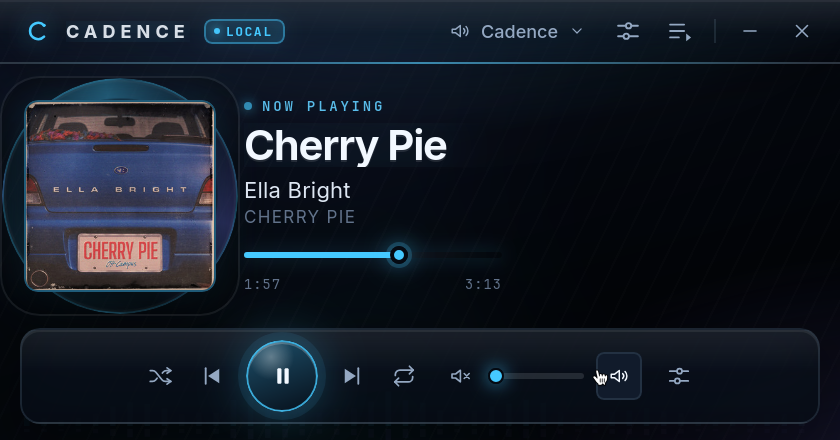
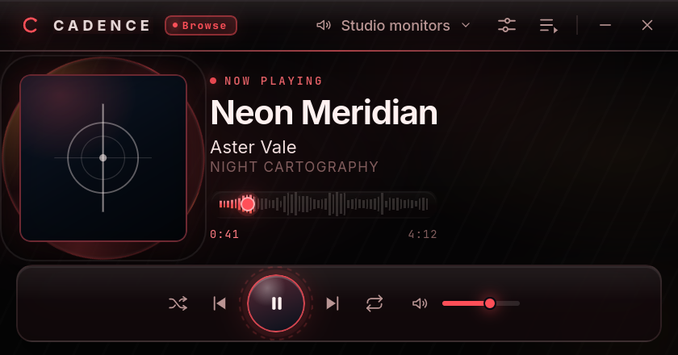
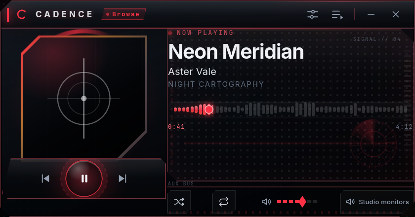
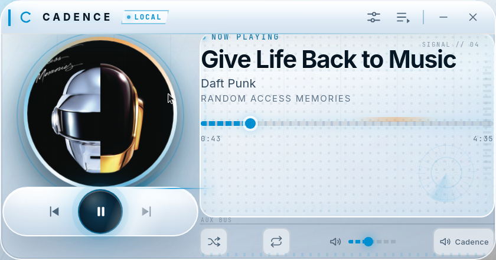
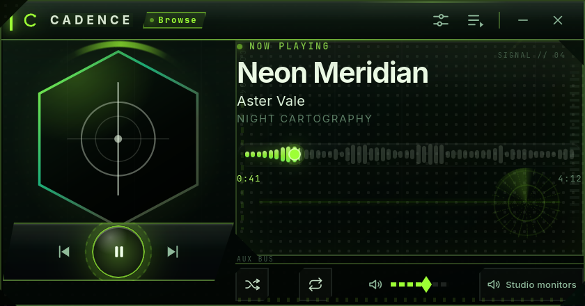
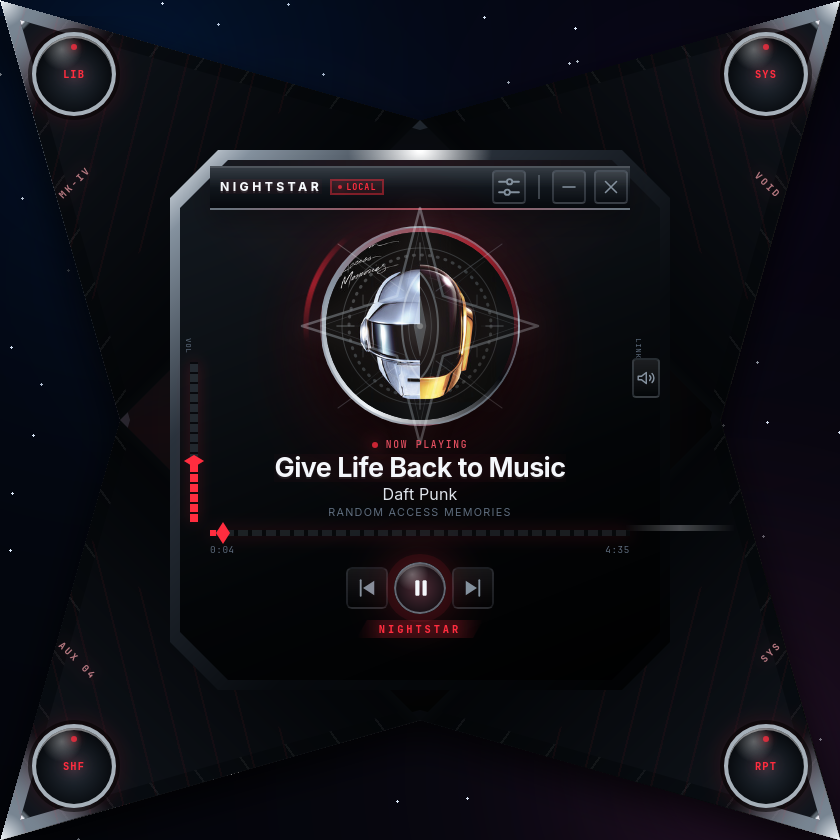
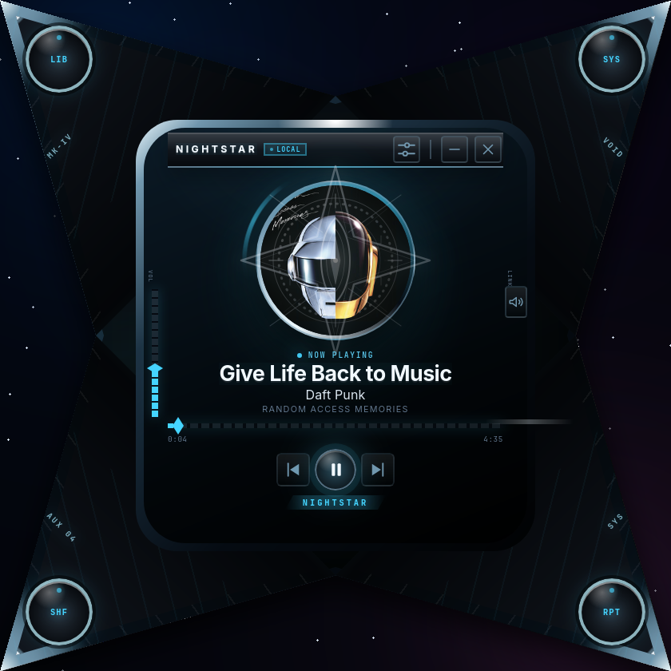
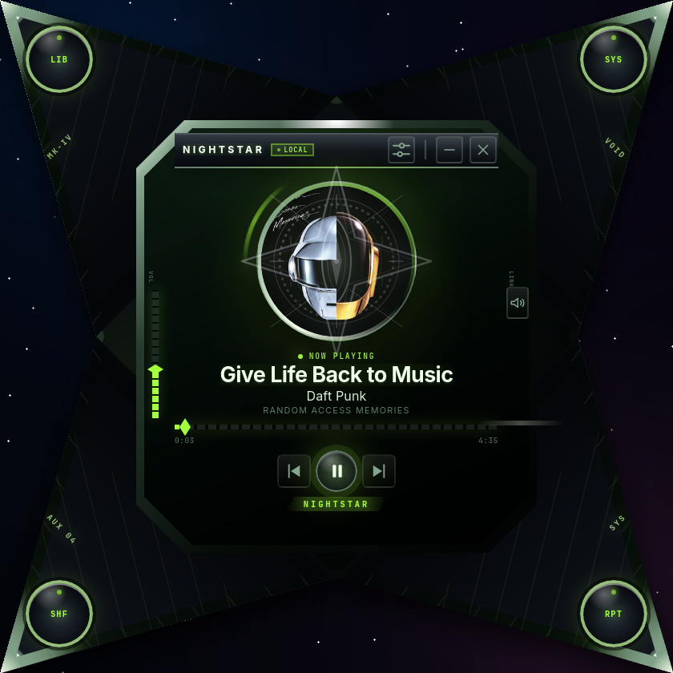

# Cadence

> **Working title.** A compact Arch Linux Spotify player with a dedicated Browse window and installable, declarative, Winamp-inspired skins.

## Status

**0.2.0: two-window playback.** Cadence is a real Spotify player. A compact,
skinnable player and a dedicated **Browse** window cover playback, search, the
user's library, podcasts, the queue and settings. Audio is decoded locally by a
managed **go-librespot** engine and plays through PulseAudio/PipeWire; the
official Spotify client is not required. Premium accounts that go-librespot
refuses can opt into **Spotify Soloist** for audio, downloaded from Spotify at
runtime. Pairing uses Spotify's device flow, and the frontend never receives
playback credentials.

- Installation: [`docs/installation.md`](docs/installation.md)
- Release history: [`CHANGELOG.md`](CHANGELOG.md)
- Implementation plan: [`plan/nombre_plan.md`](plan/nombre_plan.md)
- Development workflow: [`docs/development.md`](docs/development.md)
- Package architecture: [`docs/architecture.md`](docs/architecture.md)
- Skin format reference: [`docs/skin-format.md`](docs/skin-format.md)
- Skin authoring guide: [`docs/skin-authoring.md`](docs/skin-authoring.md)
- Spotify engine setup: [`docs/spotify-setup.md`](docs/spotify-setup.md)
- Original design baseline: [`documentacion-cliente-musical-skins.md`](documentacion-cliente-musical-skins.md)

## What it is

Cadence is a desktop **Spotify player** with two surfaces: a compact, skinnable
player and a larger Browse window for the catalog.

- **Audio is local.** A bundled or externally installed `go-librespot` process decodes and plays Spotify audio through PulseAudio or PipeWire.
- **Soloist is an opt-in fallback.** If go-librespot is refused an audio key on your Premium account, switch the audio backend to **Spotify Soloist** in Browse Settings. Soloist is downloaded from Spotify at runtime, never bundled, and requires an API key from the Spotify developer dashboard. The default backend stays go-librespot.
- **Soloist trade-offs are explicit.** Radio is unavailable in Soloist mode, and the go-librespot bitrate, FLAC, normalisation, crossfade, cache, MPRIS and speaker-group options are disabled. Soloist uses its own defaults.
- **No Spotify Desktop dependency.** Cadence appears to Spotify as a device named **Cadence** and is paired once through `spotify.com/pair`.
- **Browse is the library.** Playlists, saved albums, followed artists, Liked Songs and Your Episodes live in Browse. Search the catalog, open entity pages, queue tracks and manage saves and follows there.
- **Search and podcasts.** Search results are grouped into tracks, albums, artists, playlists, shows and episodes. Podcast episodes play through the local engine, and show pages support saving.
- **Spotify radio, locally.** Start a radio station from a track, album, artist or playlist and keep it playing through the local engine.
- **Player parity.** Browse has shuffle, repeat (off, queue, one track), seek, mute, volume and queue controls, matching the compact player.
- **One window at a time.** Opening Browse hides the compact player; closing Browse restores it without interrupting playback.
- **English and Spanish, switchable at runtime.** Choose the language in Browse Settings; the compact player and Browse window update together and the choice persists.
- **Skins are declarative.** The built-in Clarity skin is native; third-party skins are JSON layouts, CSS and local assets with no JavaScript. Skins can also create shaped, transparent windows and use declarative boxes, text, local images and custom action buttons.
- **The visualizer is real.** On Linux it captures the system-wide default PulseAudio or PipeWire monitor through `parec`; if `parec` or the monitor is unavailable it falls back to the simulated animation.
- **The demo player remains available.** Run `cadence --demo` to use the app without Spotify or network access.

Spotify playback requires a **Premium** account. The app uses the user's own
account with an unofficial client engine; see the disclaimer below. The frontend
never receives playback credentials.

The compact player remains the skinnable surface. The default skins use a
420×220 logical design space; declarative skins may declare a taller canvas up
to 420×460. The UI automatically rescales between 125% and 300% as the window is
resized (200% by default), so text stays legible without losing the compact skin
layout. The default skin, **Clarity**, is an original design inspired by the
minimal, elegant, animated cPro Pure lineage from the 2010–2015 Winamp
modern-skin era. It contains no copied skin assets. The bundled **Nightstar**
skin uses a 420×420 square canvas and a transparent shaped window.

Browse is a separate frameless window with custom chrome. It starts at 960×640,
has a 720×480 minimum, and provides a draggable topbar, minimize/close buttons
and a bottom-right resize grip.

## What it is not

- Not the official Spotify client and not affiliated with Spotify.
- Not a Spotify Connect controller; it does not need the official desktop client to play audio.
- Not a Web Playback SDK or DRM integration. WebKitGTK cannot run Spotify's Widevine/EME playback.
- Not an audio extractor. The visualizer samples the system-wide default Linux monitor, not the Spotify stream in isolation.
- Not a native Winamp skin loader in 0.2.0.
- Not a marketplace, visual skin editor or level 3 executable-skin runtime in 0.2.0.

## Architecture

```text
┌──────────────────────────── Cadence ────────────────────────────┐
│  Svelte 5 UI  ── Wails service calls/events ──  Go services     │
│                                                  │              │
│                                      playerapi.Service           │
│                                                  │              │
│                                    playback.EngineProvider      │
│                                                  │              │
│                                    engine.Supervisor            │
└──────────────────────────────────────────────────┼──────────────┘
                                                   │ loopback HTTP
                                                   ▼
                                     ┌───────────────────────────┐
                                     │ go-librespot sidecar      │
                                     │ Spotify session + audio   │
                                     └─────────────┬─────────────┘
                                                   │ PulseAudio
                                                   ▼
                                            Speakers / headphones
```

- `internal/engine/supervisor.go` owns the sidecar process, its config and pairing state.
- `internal/engine/rest.go` is the loopback REST client.
- `internal/playback/engine_provider.go` maps engine state to the provider-independent player model.
- `internal/playback/soloist_provider.go` maps the opt-in Soloist state to the same model; `internal/soloist` owns the Soloist protocol client, installer, credentials and process supervisor.
- `internal/catalog/service.go` implements library, search, context, save/follow and playback selection; `internal/wailsapi/audio/service.go` exposes it to the frontend.
- `internal/catalog` consumes a small `Playback` interface, so `PlayContext`, `PlayTrack`, `AddToQueue` and `StartRadio` reach the active backend without changing `playback.Provider`.
- `internal/artwork/cache.go` proxies and bounds album art.
- `internal/visualizer` captures the system-wide default PulseAudio/PipeWire monitor through `parec` on Linux and turns it into band, RMS and waveform frames; the frontend falls back to a simulated animation when capture is unavailable.
- `internal/buildinfo` carries the version and short commit stamped into release builds.
- `internal/platform` is the native window exception and hosts the dedicated Browse window on top of GTK4 sizing helpers.
- `internal/wailsapi/{audio,player,skins,visualizer}` are the only Wails service adapters.
- `frontend/src/app/browse/` implements the dedicated Browse window (search,
  library, podcasts, entities, queue and settings);
  `frontend/src/lib/music.svelte.ts` only tracks the local engine and pairing
  state.
- Package graph, dependency rule and event flow: [`docs/architecture.md`](docs/architecture.md).

The engine binds only to `127.0.0.1` on a random port and stores its credentials in `$XDG_CONFIG_HOME/cadence/audio/state.json`. The frontend receives token-free state. The default audio process is go-librespot. In Soloist mode, `internal/soloist` supervises Spotify Soloist and go-librespot keeps the catalog session as `Cadence Library`.

## Stack

- Go 1.26+ (development environment: 1.27.3)
- Wails `v3.0.0-beta.34` (pinned)
- Svelte 5.57.2
- Vite 8.3.5
- TypeScript 6.0.3
- Vitest 5.0.5, ESLint 10.13.0, Prettier 3.9.10
- Node.js 26.12.1 / npm 12.2.1
- go-librespot pinned to `v0.10.6-0.20261104085532-16b65bb4cd2b` (GPL-3.0 binary, separate process)
- Spotify Soloist (optional): downloaded from Spotify at runtime, never bundled; builds expire 90 days after their build timestamp

TypeScript 7 is intentionally not used because `svelte-check` 4.7.7 and `typescript-eslint` 8.72.0 are not compatible with it.

## Platform

Arch Linux x86_64 only.

## Documentation

| Document | Purpose |
|---|---|
| [`CHANGELOG.md`](CHANGELOG.md) | Release history |
| [`plan/nombre_plan.md`](plan/nombre_plan.md) | Actionable implementation plan and test gates |
| [`docs/development.md`](docs/development.md) | Local setup, commands and tooling notes |
| [`docs/architecture.md`](docs/architecture.md) | Package layout, dependency rule, event flow and the audio backend seam |
| [`docs/adr/0004-dual-audio-backend.md`](docs/adr/0004-dual-audio-backend.md) | ADR: opt-in Spotify Soloist backend next to the go-librespot default |
| [`docs/installation.md`](docs/installation.md) | Release installation, pairing and uninstall |
| [`docs/skin-format.md`](docs/skin-format.md) | Skin package, layout, theme and security reference |
| [`docs/skin-authoring.md`](docs/skin-authoring.md) | Step-by-step guide to creating and installing a skin |
| [`docs/spotify-setup.md`](docs/spotify-setup.md) | Local engine build, pairing, library and troubleshooting |
| [`documentacion-cliente-musical-skins.md`](documentacion-cliente-musical-skins.md) | Original design baseline (historical architecture sections) |
| [`docs/archive/documentacion-cliente-musical-skins.es.md`](docs/archive/documentacion-cliente-musical-skins.es.md) | Original Spanish design document (archived) |

## Prerequisites

Install the Arch Linux development and audio dependencies:

```bash
sudo pacman -S --needed go nodejs npm gtk4 webkitgtk-6.0 libsoup3 base-devel git pkgconf \
  libogg libvorbis flac mpg123 alsa-lib libpulse
```

PulseAudio or PipeWire with `pipewire-pulse` must be running for playback.

Install the pinned Wails CLI and Task:

```bash
go install github.com/wailsapp/wails/v3/cmd/wails3@v3.0.0-beta.34
go install github.com/go-task/task/v3/cmd/task@v3.54.0
```

Add the Go binary directory to `PATH`:

```bash
export PATH="$PATH:$(go env GOPATH)/bin"
```

Verify the toolchain:

```bash
wails3 doctor
wails3 version
task --version
```

## Development

Build the local audio engine and run the application:

```bash
task audio:build   # builds the pinned go-librespot into bin/go-librespot
task dev
```

Run all checks and tests:

```bash
task check
task test
```

Build the native binary or the release artifacts:

```bash
task build     # bin/cadence
task package   # AppImage, tar.gz and SHA-256 checksums in bin/
```

`task package` builds the pinned `go-librespot` engine if it is missing and bundles it in both release artifacts. The build applies the four local patches in [`build/patches/`](build/patches/): search/radio, search groups (shows/episodes), library collection writes and HTTP proxy support. Both artifacts include the Lumina, Vanta, Nightstar and Afterglow skins, README, CHANGELOG, notices, licenses and `docs/`. They are named `cadence-0.2.0-linux-x86_64.AppImage`, `cadence-0.2.0-linux-x86_64.tar.gz` and `cadence-0.2.0-SHA256SUMS`. See [`docs/installation.md`](docs/installation.md) and the [`CHANGELOG`](CHANGELOG.md).

The engine binary is not committed. `task audio:build` downloads the pinned source, applies the four patches and builds it with the local CGO libraries. Cadence also discovers `go-librespot` from `CADENCE_GO_LIBRESPOT`, `PATH` or next to the Cadence binary.

## Spotify setup

1. Build the engine with `task audio:build`.
2. Start Cadence without `--demo`.
3. Click **Browse** in the compact titlebar.
4. If the engine is not paired, copy the pairing code or choose **Open pairing page**.
5. Approve **Cadence** at `spotify.com/pair`.
6. Browse the Library, search the catalog, or play a track from Browse. Closing Browse returns to the compact player without stopping playback.

Playback requires Spotify Premium and an audio sink. The engine runs as a separate process; its log is written to `$XDG_CACHE_HOME/cadence/logs/go-librespot.log`.

See [`docs/spotify-setup.md`](docs/spotify-setup.md) for prerequisites, binary discovery, reset pairing and troubleshooting.

### Spotify Soloist (opt-in)

The default audio backend stays go-librespot. If go-librespot fails with
`failed retrieving audio key: failed retrieving aes key with code 1`, open
**Browse → Settings**, install or update Spotify Soloist, save an API key from
[`developer.spotify.com/dashboard`](https://developer.spotify.com/dashboard),
apply the **Spotify Soloist** backend and restart Cadence. Then choose
**Cadence** as the device in Spotify.

Soloist is downloaded from Spotify at runtime and is never part of the Cadence
artifact. It requires a Spotify developer API key and a Premium account. Radio
and the go-librespot bitrate, FLAC, normalisation, crossfade, cache, MPRIS and
speaker-group options are unavailable in Soloist mode. See the
[Soloist setup section](docs/spotify-setup.md#spotify-soloist-backend-opt-in)
for devices, paths, expiry and troubleshooting.

## Search and radio

Browse Search queries the Spotify catalog directly through the local engine. Results are split into **Tracks**, **Albums**, **Artists**, **Playlists**, **Shows** and **Episodes**. Tracks and episodes play immediately, the other result types open entity pages, and tracks plus album, artist and playlist pages have a **Radio** action. Library Liked Songs and Your Episodes also open their own views.

Radio stations are resolved by the engine and play through the same local output as normal tracks. This requires Spotify Premium, like playback. Radio is only available with the go-librespot backend; the action is hidden in Soloist mode.

## Skins

Clarity is the built-in native skin and is always available. Declarative skins are installed from a directory or ZIP in the skin library. They contain JSON layouts, CSS and local assets; no skin JavaScript is executed.

The included **Lumina** development skin is an original, glossy media-player design inspired by the Windows Media Player era. It adds chrome surfaces, animated ambient light, a rotating album-art halo, LED status accents, glowing transport controls and four themes: Azure, Carbon, Ember and Violet. No WMP or The Skins Factory artwork is copied.





**Vanta** is a full cockpit redesign rather than a palette swap. The album art becomes a reactor core on the left, the transport is mounted in a blade-shaped pod, the track readout lives in an angular telemetry display with a rotating scan scope, and the queue opens as a slide-out data bay. The themes change the geometry too: **Darkstar** uses chamfered carbon panels and an octagonal core, **Bionic** uses a glossy circular core and rounded glass panels, and **Reactor** uses a hexagonal core and a slanted blade pod. It is also original CSS artwork.







**Nightstar** is a separate skin built around a four-blade star chassis, the shape language of mid-2000s sci-fi Windows Media Player skins. The native window is transparent, so only the chrome star is visible over the desktop. A compact chrome-framed console holds the album art and sigil, track readout, LED progress, transport and vertical side rails; the four arms end in circular metal pads. It has three themes: **Crimson**, **Ion** and **Toxin**.

The original Alienware Darkstar was a black, red and chrome four-point shuriken with a central emblem and tactile arm controls. Nightstar is an original interpretation of that silhouette, not a copy: the star, sigil, chrome panels and emblems are original CSS and PNG artwork. The screenshots use a space backdrop to show the transparent window; in the app, the desktop shows through around the star.







Nightstar also exercises the new skin primitives (`box`, `text`, `image`, `button`) and the shaped-window support documented in [`docs/skin-format.md`](docs/skin-format.md).

Development skins live in [`skins-dev/`](skins-dev/) and are discovered automatically when Cadence runs from the repository root. The included **Afterglow** skin demonstrates a different layout, theme files and the Shadow DOM runtime.

```bash
./bin/cadence --skins-dev ./skins-dev   # load development skins
./bin/cadence --safe-mode               # built-in skin only, session-only
./bin/cadence --demo                    # simulated player, no Spotify engine
```

See [`docs/skin-format.md`](docs/skin-format.md) and [`docs/skin-authoring.md`](docs/skin-authoring.md) before creating a skin.

### Wayland and tiling compositors

Cadence requests the active skin's logical size at the current UI scale; tiling compositors such as Sway and i3 decide the final geometry. Add a floating window rule for the app:

```text
for_window [app_id="io.github.ivandec0.cadence"] floating enable
```

Most skins use an 840×440 physical window (420×220 logical at 200%). Nightstar uses 840×840 (420×420 logical). The compact queue expands the same window vertically to 920 px tall at 200%, and the height follows the current UI scale. Browse is a separate 960×640 window (720×480 minimum) with its own draggable topbar and bottom-right resize grip. The compact titlebar provides its drag region; window controls are marked as non-draggable.

Shaped windows need a compositing environment with an alpha channel. Sway and the common Wayland compositors support it. If a compositor forces an opaque window background, the star's silhouette will be surrounded by that background instead of the desktop.

## Repository layout

```text
.
├── main.go                          # Wails entry point, window options and service wiring
├── Taskfile.yml                     # Developer commands
├── build/                           # Wails metadata and Linux build tasks
├── frontend/                        # Svelte 5 + TypeScript UI
├── internal/
│   ├── engine/                      # Sidecar supervisor, REST client and wire DTOs
│   ├── catalog/                     # Library, search and context orchestration
│   ├── playback/                    # Provider, player state, demo and engine providers
│   ├── soloist/                     # Opt-in Soloist protocol, installer and process supervisor
│   ├── artwork/                     # Album-art proxying and caching
│   ├── visualizer/                  # Monitor capture and spectrum/RMS/waveform analysis
│   ├── buildinfo/                   # Release version and commit stamping
│   ├── diagnostics/                 # Counters and engine transport instrumentation
│   ├── skins/                       # Skin validation, installation and runtime support
│   ├── settings/                    # Persisted configuration
│   ├── platform/                    # GTK4 window sizing, transparency and Browse host
│   └── wailsapi/
│       ├── audio/                   # Wails audio adapter (audioapi)
│       ├── player/                  # Wails player adapter (playerapi)
│       ├── skins/                   # Wails skins adapter (skinsapi)
│       └── visualizer/              # Wails visualizer adapter (visualizerapi)
├── skins-dev/                       # Development skins: Afterglow, Lumina, Vanta and Nightstar
├── documentacion-cliente-musical-skins.md
├── plan/
│   └── nombre_plan.md
├── docs/
│   ├── adr/
│   │   └── 0004-dual-audio-backend.md
│   ├── architecture.md
│   ├── development.md
│   ├── installation.md
│   ├── i18n.md
│   ├── skin-format.md
│   ├── skin-authoring.md
│   ├── spotify-setup.md
│   └── archive/
├── CHANGELOG.md                     # Release history
├── .github/workflows/ci.yml         # Arch Linux CI skeleton
├── LICENSE                          # MIT (code)
├── LICENSE-ASSETS                   # CC BY-SA 4.0 (original skin assets)
├── THIRD-PARTY-NOTICES.md           # Engine and runtime attributions
└── LICENSES/
    └── go-librespot-GPL-3.0.txt     # GPL-3.0 text for the separate engine
```

## License

- **Cadence code:** MIT. See [`LICENSE`](LICENSE).
- **Original skin assets and visual documentation:** CC BY-SA 4.0. See [`LICENSE-ASSETS`](LICENSE-ASSETS).
- **go-librespot:** GPL-3.0. It is a separate process and is not linked into Cadence. See [`THIRD-PARTY-NOTICES.md`](THIRD-PARTY-NOTICES.md) and [`LICENSES/go-librespot-GPL-3.0.txt`](LICENSES/go-librespot-GPL-3.0.txt). This project is intended for private personal use, not distribution.

Third-party trademarks, fonts and assets remain the property of their respective owners.

## Disclaimer

Spotify, Winamp and cPro are trademarks of their respective owners. Cadence is not affiliated with Spotify, Nullsoft, Winamp or the cPro authors.

Cadence uses `go-librespot`, an unofficial open-source Spotify client. It relies on reverse-engineered Spotify protocols, may stop working at any time, and may be considered outside Spotify's terms. Use it only with your own Premium account and at your own risk. The default Clarity skin is an original design; downloaded Winamp skins and copyrighted recreations are not part of this repository.
